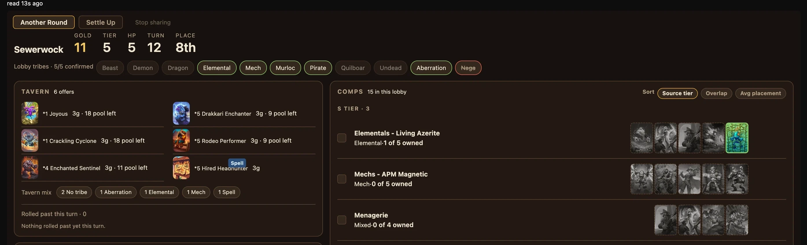
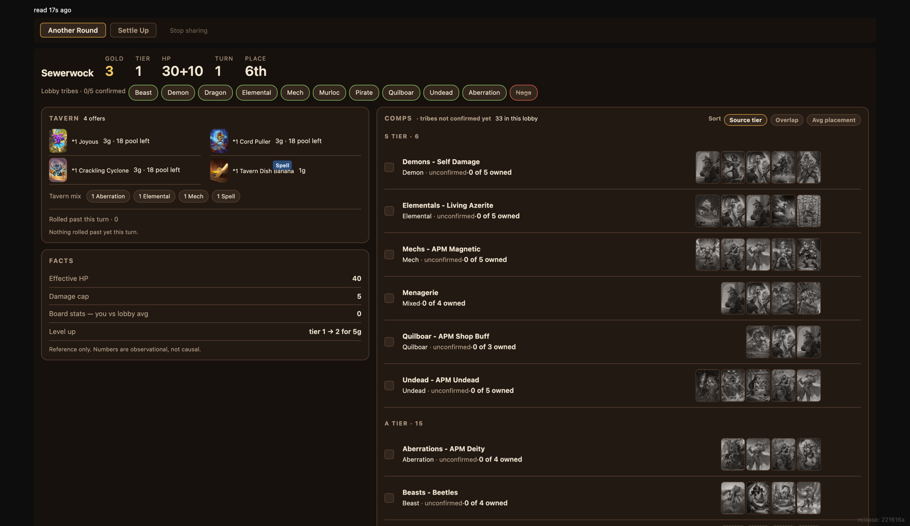
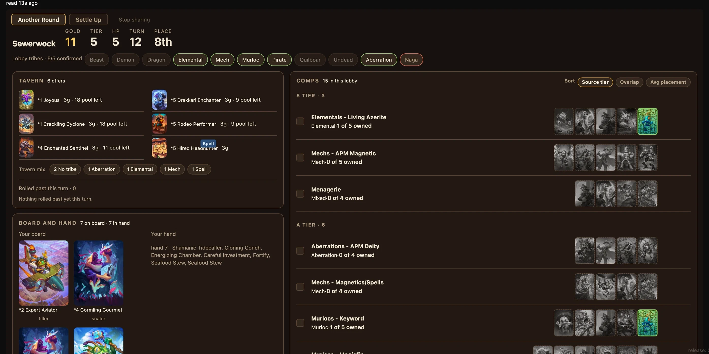
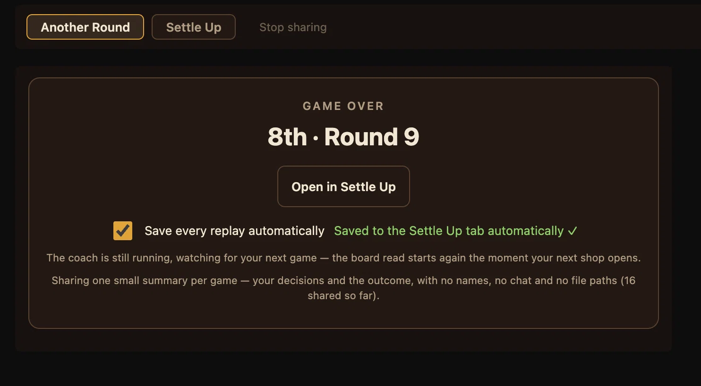
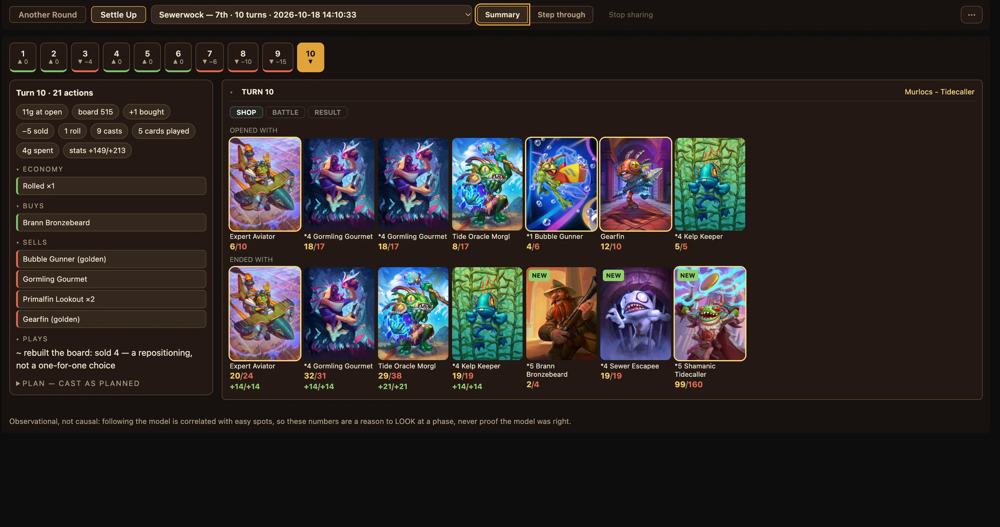
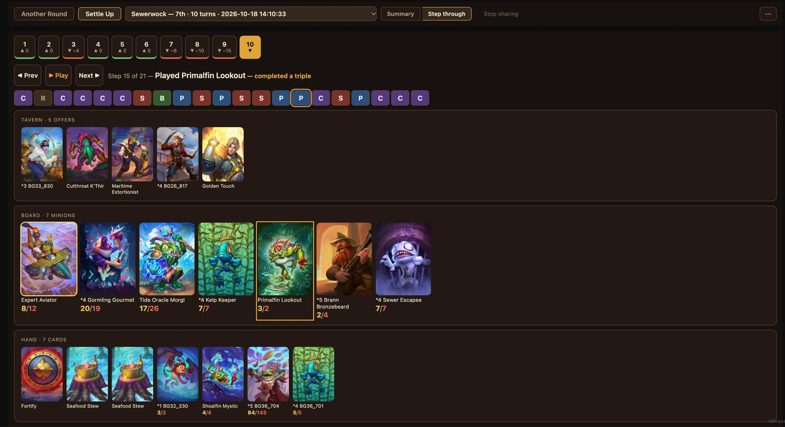

# Bob's Ledger

Bob's Ledger is a tracker for **Hearthstone Battlegrounds** on Windows and macOS. It reads the game's own `Power.log` text file from your disk and shows you the state of your game in a local web page: your board and what each minion is worth, the tavern's offers, the next opponent, how close you are to dying, and which comps are available. A second page, **Settle Up**, reviews finished games. Everything runs on your own machine, and it asks for no account.



*Another Round, late in a game: the tavern, the lobby tribes, and the comps this lobby can build.*

## What you need

- A Windows PC or a Mac with Hearthstone installed — on any drive or folder.
- Python 3 — free. If it is missing, the launcher tells you and offers the download page.
- Five minutes, most of it the download.

## Set up on Windows

1. **Download it.** [Download the latest release](https://hearth-telemetry-collector.bobs-ledger.workers.dev/release/latest.zip) — it saves as `Bob's Ledger.zip`. No account needed.
2. **Unzip it.** Right-click the file, choose **Extract All**, and pick a place you can write to, such as the Desktop or Documents. Not `C:\Program Files` — Windows will not let the app keep its card pictures there. You get a folder called `Bob's Ledger`.
3. **Open that folder and double-click `Start Bob's Ledger.cmd`.** That is the whole setup: it finds Python, asks before adding the one small extra it needs, says where it will read Hearthstone's log from, offers a shortcut with its own icon for the folder and your Desktop, and offers to turn on logging.
4. **If Windows asks** whether to run a file from an "unknown publisher" — the normal warning for anything you downloaded — click **Run**.
5. **Say yes to the logging question**, and the page opens in your browser. Leave the window that opened open while you play.

## Set up on macOS

1. **Download it.** [Download the latest release](https://hearth-telemetry-collector.bobs-ledger.workers.dev/release/latest.zip) — it saves as `Bob's Ledger.zip`. No account needed.
2. **Unzip it.** Double-click the file in Finder, and you get a folder called `Bob's Ledger`. Put it somewhere you can write to, such as Documents — not inside `/Applications`.
3. **Open that folder and double-click `Start Bob's Ledger.command`.** It finds Python, asks before adding the one small extra it needs, says where it will read Hearthstone's log from, and offers to turn on logging.
4. **If macOS refuses to open it** — a warning about an unidentified developer, or nothing happens at all — run it from Terminal instead. Open Terminal, type `cd ` (with a space after it), drag the `Bob's Ledger` folder onto the Terminal window, press Return, then run:

   ```
   bash "Start Bob's Ledger.command"
   ```

5. **The first run may offer to build a private Python folder beside the app.** That folder is where the one Python package it needs goes, and it keeps that package out of the rest of your Mac. Say yes. If Python 3 is missing, the launcher offers the download page; `xcode-select --install` in Terminal installs it too.
6. **Say yes to the logging question**, and the page opens in your browser. Leave the Terminal window open while you play.

## Turn on Hearthstone's logging

By default Hearthstone does not write the file Bob's Ledger reads.

**The app offers to do this for you.** If logging is off when you start it, it asks. Say yes and the step is done: it adds the lines it needs to the settings file Hearthstone already has, leaves the rest of that file exactly as it was, and keeps a copy of the original first. It will not do it while Hearthstone is running, because the game only reads that file when it starts.

**It also lifts Hearthstone's 10 MB log cap, in the same step.** Hearthstone closes a log file once it reaches its size limit — 10 MB by default — and everything after that point is never written, which loses the end of a long session. The limit is one of the game's own settings (`Log.FileSizeLimit.Int`, default `10000`), so the app sets it to `-1`, the game's "no limit", in `client.config` beside the game. Same care as above: that one line, every other line kept, the original backed up, and only when you say yes. The page also says so on screen if a log ever does hit the cap.

### By hand on Windows

1. Close Hearthstone.
2. Hold **Win**, press **R**, paste `%LocalAppData%\Blizzard\Hearthstone` and press Enter to open that folder.
3. Open `log.config` with Notepad — or create it there. Its full path is `%LocalAppData%\Blizzard\Hearthstone\log.config`. Make sure it contains at least this:

   ```
   [Power]
   LogLevel=1
   FilePrinting=true
   ConsolePrinting=false
   Screenshots=false
   ```

4. Start Hearthstone.

### By hand on macOS

1. Close Hearthstone.
2. In Finder, press **Command-Shift-G**, paste `~/Library/Preferences/Blizzard/Hearthstone` and press Return to open that folder.
3. Open `log.config` with TextEdit — or create it there; its full path is `~/Library/Preferences/Blizzard/Hearthstone/log.config`. Make sure it contains at least the same `[Power]` block shown above. In TextEdit, choose **Format > Make Plain Text** before saving.
4. Start Hearthstone.

To lift the size cap by hand, put `Log.FileSizeLimit.Int=-1` in `client.config` in the Hearthstone install folder (`/Applications/Hearthstone` on macOS). If you use Hearthstone Deck Tracker or Firestone, `log.config` exists already, so only the cap line above is still needed.

## What it does to your machine

Bob's Ledger reads a text file the game writes. It "does not touch the game's process or its memory", it "does not automate input", and it "reads the log file Hearthstone writes to your own disk".

The only files it can change are two of Hearthstone's own settings — the logging switch in `log.config` and the log-size cap in `client.config` — and only if you say yes to turning logging on. Each edit keeps a copy of the original. Everything else Bob's Ledger writes stays inside its own folder, except card art when that folder is read-only: art then goes to a per-user cache (`%LOCALAPPDATA%\bobs-ledger` on Windows, `~/Library/Caches/bobs-ledger` on macOS).

Nothing is sent anywhere to produce what the page shows. Every number is worked out on your machine from Hearthstone's log plus a reference file that ships with the app, and the page works with your internet off; only the card pictures need a connection.

## The two pages

The page has two tabs: **Another Round**, the live view, and **Settle Up**, the review of finished games. The tab you are on is remembered across a reload, and switching between them never interrupts the live view.

### Another Round

This is where you start, and it updates as you play. It opens as a page in your browser, not a second game window, so put it on another monitor or leave it behind the game.



*Another Round at the first shop, before the five lobby tribes are tapped: the tavern's offers and the facts are already read, and the comps are listed but dimmed until the tribe row is set.*



*Later in the game: the tavern's six offers, a full board and hand, and the comps list marking the core cards you already own.*

- **On a shop screen, the status bar at the top** — the hero, then gold, tier, health (with armour when you have any), turn and place. A number that has not been read yet is a dash, never a guess. The page's one read-age line at the very top says how old the current frame is.
- **One row of lobby tribes.** On a shop screen it sits under the status bar; on a hero pick it sits above the hero cards. Tap the five tribes the tavern is offering this game — the same five the game's own minion-types panel shows you at hero select — and every comp and count on the page is exact from turn 1.
- **On a shop screen, the sections below** show where the game stands:
  - **Tavern** — the tavern's offers, the mix of tribes on offer, and the offers rolled past during this turn.
  - **Board and hand** — your board as cards with a one-line caption under each, and your hand as one line with its count and card names. The panel is not shown when both are empty.
  - **Facts** — effective health, what the last fight cost, what the last three fights cost, the per-combat damage cap, your board's stats against the last board seen (or the lobby average when no exact board was read), and what levelling up costs. The section is not shown until it has a value to print.
  - **Comps** — the comps this lobby offers, counted in the panel header, grouped by source tier. Each shows its name and tribe, its core cards, how much of the core you hold, and — where this project's game corpus has one — an average placement. Sort by tier, overlap or average placement; open a comp for its core and flex cards and its written guide; tick up to three to compare. Comps for rotated-out tribes sit in a collapsed **Out of play** section, and comps for tribes this lobby does not offer are not listed.
  - **Next opponent** — their hero, the board they last staged, what it was worth with how many rounds ago that was read, and their tribe mix.
- **The page follows the moment.** A hero pick shows the tribe row and the hero cards, with no status bar or shop panels. A trinket or Discover pick puts the cards above the shop panels, with the shop panels reduced to their headers and one-line summaries. Between shops, the last snapshot is shown dimmed. Empty panels are left out, apart from Comps' named empty state.
- **When the game asks you to choose** (a hero, a trinket, a Discover), the panel shows what is known about each option, in the order the game offered them and never in an order that means "take this one". A hero card shows its power and how often the population picks it; a trinket shows how often it is picked, its average placement and how often it finishes top 4; a Discovered card shows its tier and tribe, or `No data` when there is none. Those population numbers come from a reference file bundled with the app, built from public statistics on hsreplay.net and read offline; the source line names the patch they were read against. Nothing there is a recommendation.
- **The layout follows your window.** A big desktop window is two columns: the shop's panels on the left and Comps on the right. Every other window is one column of sections you open and close by clicking their headings, with the **Facts** table pinned above them; each heading carries a one-line summary of what is under it (Facts speaks in its rows), and which sections are open is remembered.

Board cards show their stats and their role caption, with the full card — including its tier and text — on hover. The tavern's offers keep the order the game shows them, not a ranking. When a game ends, the card on screen shows the placement and round large, an **Open in Settle Up** button, and the save-every-replay answer on one line.



*Another Round's game-over card: the placement and round, the way into Settle Up, and the save answer on one line.*

### Settle Up

When a game ends, the card offers **Save replay** unless **Save every replay automatically** is already on. Saving keeps that game in the **Settle Up** tab: pick any saved game from the dropdown and the turn-by-turn view opens. The card also carries a **Save every replay automatically** checkbox — leave it ticked and each finished game is kept as its review builds. Saving is per game and yours alone; saved games stay on your machine.



*Settle Up's **Summary** view: the turn rail, the board you opened and closed with, and the plan read for the turn.*

A strip of turn buttons runs along the top, each marked with the result and the HP the fight cost. In the **Summary** view, each turn has three tabs:

- **Shop** — the board you opened with and the board you closed the shopping on, with each minion's net change marked on the card, and a *passed through* tray for anything you bought and sold again in the same phase.
- **Battle** — the two boards facing each other, theirs on top, the way the game shows a fight, with the result beside them.
- **Result** — who won, or a line saying the turn's fights ran together and the winner cannot be read; what each side kept; and what the fight cost you in effective HP.

In Summary, a rail down the side carries the turn's own numbers — gold at the open, cards played, gold spent, board value — and groups what the turn did: buys, sells, plays, rolls and levelling up, with repeats collapsed and a count of each.

Each advised phase also gets a folded **Plan** entry in that rail, headed by the model's grade — for example **taken**, **cast as planned**, **not taken**, or **not graded**. Open one for the line itself, for example "1. LEVEL to tier 4 · 2. Buy Bronze Warden". A phase the review cannot grade — one that opens with a minion swap, or with a spell whose card it cannot read — is reported as **not graded** with the reason, not guessed.

The page footnote says plainly that this is **observational, not causal**: following a line is easier in games you were already winning. Read it as a reason to look at a turn, never as a score.

A fight's summoned copies linger in the log past the end of the fight, so the board you opened with is shown without them; a turn where that happened says so under the board. The header carries a **Summary | Step through** switch: Step through replays the turn one action at a time, with a tick per action, the board as it stood after that action, and a card you sold shown dimmed and tagged. Left and Right walk turns, or steps while stepping; Shift with them walks turns while stepping; Space plays and pauses while stepping; Home and End jump to the ends. The mode is remembered. The **⋯** menu has **Rebuild**, which re-derives any saved game from its own log; an older saved game opens Step through disabled, with a tooltip saying why.

**Every card is named from the game's own log.** A minion the bundled reference tables have never heard of — a rotated minion discovered into a fight, a spell from another set, a summoned token — still shows its real name instead of a card id, in both views. Games saved before that naming existed pick it up when you **Rebuild** them.



*Settle Up's **Step through** view: every action in the turn on one tick row, the board as it stood after Step 15, and the card just played highlighted.*

## The one question it asks you

The first time it starts, Bob's Ledger asks whether it may send a short summary of each finished game back to the project. **Nothing is sent unless you say yes**, and saying no changes nothing else about the app.

Saying yes covers the games you play **from that point on**. Anything you played before you answered — while the answer was no, or before there was one — is never sent, not even after you say yes.

If you say yes, a summary is a distilled record of the state the page had at each advisory. It includes turn, gold, tavern tier, health, the board's count and stats, the suggested line the page showed, the comp being targeted and its progress, the tribes seen and banned, the announced opponent's hero and board, **where you finished**, and what each fight cost you in effective HP. Not your name, not the chat, not your file paths, and not your log file. A copy of everything sent is kept in `session_reports/` in the app folder, so you can read it yourself.

To change your mind, use the sharing control beside the tabs at the top of the page — a small greyed-out line. It is there once you have answered, including in the middle of a game, and it flips either way. The question itself is only asked once, when you have not answered yet.

## If something's wrong

- **A black window flashes and vanishes (Windows).** You ran the file from inside the .zip. Unzip it first, then run it from the folder you get.
- **macOS refuses to open the launcher.** Run it from Terminal instead, as in the macOS steps above: `bash "Start Bob's Ledger.command"`.
- **It says Python was not found.** On Windows, install Python from python.org, tick **Add python.exe to PATH**, and run the file again. On macOS, the launcher offers the download page, and `xcode-select --install` in Terminal installs it too.
- **The page keeps waiting.** Two things cause that, and the page says which one you have. Either Hearthstone's file logging is still off — the page shows that same setting on screen — or Bob's Ledger is looking in the wrong place, because your game is installed somewhere other than the usual folder. The window you started it from prints the one-line command that fixes the second one for good.
- **The page stops changing.** The page says how long ago the last read was written, so you can tell a stale read from a live one. If it instead says the log stopped, Hearthstone hit its own size cap and closed the file — that is the cap the launcher removes for you (see [turning on logging](#turn-on-hearthstones-logging)). Until you restart the game with it removed, the rest of that session is not recorded.
- **It says the page needs its access key.** The page listens only on your own machine, and the address the launcher opens carries a key made fresh for that run — so a plain `http://127.0.0.1:8747/` you bookmarked yourself is refused until the launcher has opened the page once. From then on that browser remembers the key and the plain address works. Restarting mints a new one, so a bookmark made yesterday says so rather than showing you old state; opening it from the launcher once fixes that too.
- **The app folder is read-only.** Card art falls back to a per-user cache, so the page still works. Saved replays and shared reports live in the app folder, so move it to Documents or the Desktop if you want those written.
- **After a Hearthstone patch.** The reference data the page uses can lag a few days behind a patch, so its numbers can be less sharp until it catches up. It looks for a new version every time you start.

Still stuck? [Open an issue](https://github.com/mharrell/bobs-ledger/issues) with what the window said, or a screenshot of it.

## Uninstalling

Delete the `Bob's Ledger` folder, and the shortcut if you made one. No registry entries, no services.

On Windows, if you said yes to installing the one Python package, `requests` lives in the Python you chose and stays there; Python itself is unchanged. On macOS it lives in the app's private `.venv` and goes with the folder.

On a read-only install, card art may live in the per-user cache named above; delete that folder too if you want it gone.

If you said yes to turning on Hearthstone's logging, the two settings it changed in Hearthstone's own files stay as they are. Those are Hearthstone's files, and file logging on is what other trackers use too; deleting Bob's Ledger does not turn them back off.

## Licence and credits

MIT licensed — see `LICENSE`. Card names, card text and card art are © Blizzard Entertainment, and this is an unofficial fan tool: not affiliated with, or endorsed by, Blizzard. Card data comes from [HearthstoneJSON](https://hearthstonejson.com), and the sources behind the comp reference are credited inside `meta/comps.json`.
