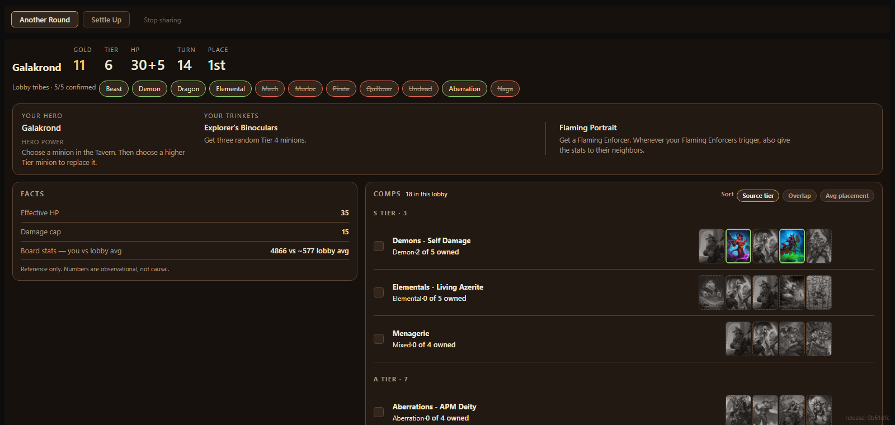
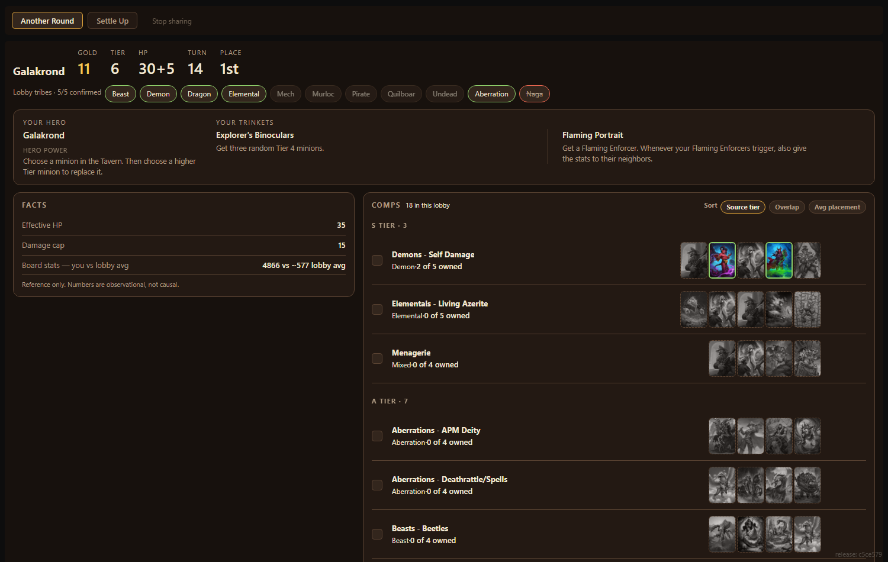

# Bob's Ledger

A replay viewer and reference panel for **Hearthstone Battlegrounds**. It reads the
log file the game writes on your own PC, shows reference information while you
play, and after each game builds a turn-by-turn review of what you did and what
happened.

The planner is a hand-written, rule-based scoring and planning function that
runs locally; there is no machine learning and no language model involved.

**It does not tell you what to do during a game.** The live view shows state and
reference data, never a move. See [Is this allowed?](#is-this-allowed).

**Windows and macOS.** It asks for no account, does not touch the game's
process or its memory, and does not automate input.

**[Install](#install)** · **[Turn on logging](#turn-on-hearthstones-logging)** · **[Is this allowed?](#is-this-allowed)** · **[Privacy](#privacy-and-the-optional-summary)** · **[Troubleshooting](#if-something-is-wrong)**


## What it does

The app opens as a page in your browser with two tabs.

### Settle Up: the review

Pick a finished game and step through it turn by turn. Each turn has three views:

- **Shop:** your board when you entered the shop, your board when you left it,
  and every buy, sell, roll, level-up, cast, and play in between.
- **Battle:** both boards after start-of-combat effects.
- **Result:** what survived, who won, and the damage taken.

Two ways to read a game:

- **Summary:** one card per turn, with the actions collapsed to a short list.
- **Step through:** one action at a time, with the tavern, your board, and your
  hand laid out the way the game screen does it.

Settle Up only opens after a game ends. It also has a post-game "what might have
been better" layer. It is rough, it is often wrong, and it is off unless you
switch it on. Everything in it is observational, not causal: following its plan
is easier in games you were already winning, so read it as a reason to look at a
turn, never as a score. Turns it cannot judge are marked **not graded** and
counted, not guessed.

### Another Round: live reference



A reference panel that updates as you play:

- Hero and trinket pick statistics, plus tier and tribe on discover options (a
  reference file bundled with the app, built from HSReplay population statistics
  and labelled with the patch it was read against)
- A comp tracker: which comps your board is close to and which pieces you hold
- Your standing in numbers: effective health, what the last fight cost, what
  the last three cost, the damage cap, your board's stats against the next
  opponent's last-known board (or the lobby average), and the price of the next
  tier.




Nothing on this tab names a move. A test in this repository checks that the live
payload carries no plan, no named buy, and no pick.


## Install

You need a PC or a Mac with Hearthstone installed and Python 3 (free; the
launcher tells you if it is missing and links to it).

### Windows

1. **Download:** [latest release](https://github.com/mharrell/bobs-ledger/releases/latest).
2. **Unzip** it somewhere you can write to, such as Documents or the Desktop. Not
   `C:\Program Files`.
3. **Double-click `Start Bob's Ledger.cmd`.** It finds Python, asks before
   installing the one small extra package it needs, and opens the app in your
   browser.

Windows may warn about an "unknown publisher" for anything downloaded. Click
**Run**.

### macOS

1. **Download:** [latest release](https://github.com/mharrell/bobs-ledger/releases/latest).
2. **Unzip** it in Finder, somewhere you can write to, such as Documents. Not
   `/Applications`.
3. **Double-click `Start Bob's Ledger.command`.** It finds Python 3, asks before
   installing the one small extra package into a private folder beside the app,
   and opens the app in your browser. Leave its Terminal window open while you
   play; closing it stops the app.
4. **If macOS refuses to open it** — a warning about an unidentified developer,
   or nothing happens — run it from Terminal instead: type `bash ` with a space,
   drag the file onto the window, and press Return.
5. **If Python 3 is missing**, the launcher offers the download page; in
   Terminal, `xcode-select --install` installs it too.

## Turn on Hearthstone's logging

By default Hearthstone does not write the file this app reads. If logging is off
when you start the app, it offers to set it up: it writes the two logging lines
into the `log.config` file Hearthstone already uses and sets
`Log.FileSizeLimit.Int=-1` in `client.config` beside the game, which lifts the
10 MB cap the client puts on its log. Each file keeps a backup of its original,
and nothing else in either is changed. It will not do this while Hearthstone is
running.

To do it by hand on Windows:

1. Close Hearthstone.
2. Press **Win + R**, paste `%LocalAppData%\Blizzard\Hearthstone`, press Enter.
3. Open (or create) `log.config` and make sure it contains:

```
[Power]
LogLevel=1
FilePrinting=true
ConsolePrinting=false
Screenshots=false
```

4. Open (or create) `client.config` in the Hearthstone install folder — the one
   holding `Hearthstone.exe`, usually `C:\Program Files (x86)\Hearthstone` —
   and add `Log.FileSizeLimit.Int=-1`, which lifts the 10 MB cap on the log.
   Windows may need Notepad run as administrator to save a file there.
5. Start Hearthstone.

To do it by hand on macOS:

1. Close Hearthstone.
2. In Finder, press **Command-Shift-G**, paste
   `~/Library/Preferences/Blizzard/Hearthstone`, press Return.
3. Open `log.config` there in TextEdit — choose **Format > Make Plain Text**
   before saving — or create it, and make sure it contains the same `[Power]`
   block.
4. Open (or create) `client.config` in the folder holding `Hearthstone.app`
   (`/Applications/Hearthstone`) and add `Log.FileSizeLimit.Int=-1`.
5. Start Hearthstone.

If you use Hearthstone Deck Tracker or Firestone, `log.config` is already set
up; the `client.config` line above is separate.

## Is this allowed?

Not guaranteed, and this section does not pretend otherwise.

- Blizzard's EULA ([Section 1.C](https://www.blizzard.com/en-us/legal/fba4d00f-c7e4-4883-b8b9-1b4500a402ea/blizzard-end-user-license-agreement))
  prohibits software that "facilitates the gameplay" or grants "an advantage over
  other players not using such methods." A statistics overlay can fall under that
  wording. Read it yourself rather than relying on this summary.
- What this app does not do: touch the game's process or memory, automate input,
  or show hidden information. It reads the log file Hearthstone writes to your
  own disk.
- It writes two of Hearthstone's own config files — `log.config` and
  `client.config` in the game's install folder — only when you say yes, and keeps
  a backup of each one it changes.
- Tools that read the same log, such as Deck Tracker and Firestone, have been used
  openly for years. That is a reason to think this is tolerated. It is not a
  promise.
- The live view shows state, not instructions. The plan is worked out and
  saved on your disk, and you see it after the game, when it can no longer be
  acted on.
- **Do not use it in tournaments or organised events.** Their rules bar outside
  help outright.
- If you draw the line at raw data, the answer is not to run it.

I am not a lawyer and this is not legal advice.

## Privacy and the optional summary

Everything on screen is computed on your PC from the log file plus reference data
that ships with the app. It works with your internet off. Only card images need a
connection.

The first time you start it, the app asks whether it may send a short summary of
each finished game. **Nothing is sent unless you say yes**, and saying no changes
nothing else.

- It covers only games you play after you say yes.
- A summary holds decisions and outcomes: turn, gold, tavern tier, health, what
  the planner suggested, and what happened next. It does not hold your name, chat,
  file paths, or the log file.
- A copy of everything sent is kept in `session_reports/` in the app folder.
- The exact fields allowed are listed in `session_report.py` (`SPEC`). A field not
  listed there cannot be sent.
- To change your mind, click **Stop sharing** beside the tabs at the top of the
  page; the control reads **Turn sharing on** while sharing is off.

With your yes, a summary is posted to the project's collector at
`https://hearth-telemetry-collector.bobs-ledger.workers.dev` and stored in its
Cloudflare KV namespace. The operator's notes are in
[`telemetry/README.md`](telemetry/README.md), which does not state a retention
period.

Why it exists: the plan has not been measured against results, and these
summaries are how it gets measured.

## What it cannot do

The planner behind the review is a second opinion, not an oracle. Its judgements
have not been checked against outcomes, and some, especially about when to level
up, may be wrong. After a Hearthstone patch the reference data can lag by a few
days.

## If something is wrong

- **A black window flashes and closes (Windows):** you ran the file from inside
  the zip. Unzip first.
- **macOS refuses to open the launcher:** run it from Terminal instead, as in
  the macOS steps above: `bash "Start Bob's Ledger.command"`.
- **Python was not found:** install it from python.org and tick **Add python.exe
  to PATH**. On macOS, `xcode-select --install` installs it too.
- **The app keeps waiting:** either Hearthstone's logging is still off, or the app
  is looking in the wrong folder because your game is installed somewhere
  unusual. The app says which, and the window you started it from prints the
  fix.
- **The folder cannot be written to:** move `Bob's Ledger` to Documents or the
  Desktop.

Still stuck? [Open an issue](https://github.com/mharrell/bobs-ledger/issues) with
what the window said.

## Uninstall

Delete the `Bob's Ledger` folder, and the shortcut if you made one (Windows).
Nothing else was installed. On macOS the private Python folder the launcher may
have made (`.venv`) sits inside that folder, so it goes too.

## Licence

MIT, see `LICENSE`. Card names, text, and art are © Blizzard Entertainment. This
is an unofficial fan tool, not affiliated with or endorsed by Blizzard. Card data
comes from [HearthstoneJSON](https://hearthstonejson.com). Comp sources are
credited in `meta/comps.json`.

## For contributors

```
git clone https://github.com/mharrell/bobs-ledger
cd bobs-ledger
python -m pip install -r app/requirements.txt
python app/live.py
```

Tests: `python -m unittest discover -s app/tests` (a large test suite).
Two are posture controls: one checks this README's claims about what the app does
to your machine, and one checks that the live payload carries no verdict.

Nothing on the live path calls a language model. Everything on the page comes from
the local value function and the meta database, apart from card art, which is
fetched over HTTPS. The language-model tooling in the tree is for maintainer work
and is not shipped in releases.

Design notes, working rules, and the roadmap are in `DESIGN.md` and `ROADMAP.md`.
History of the project's direction is in `PIVOT.md`.
